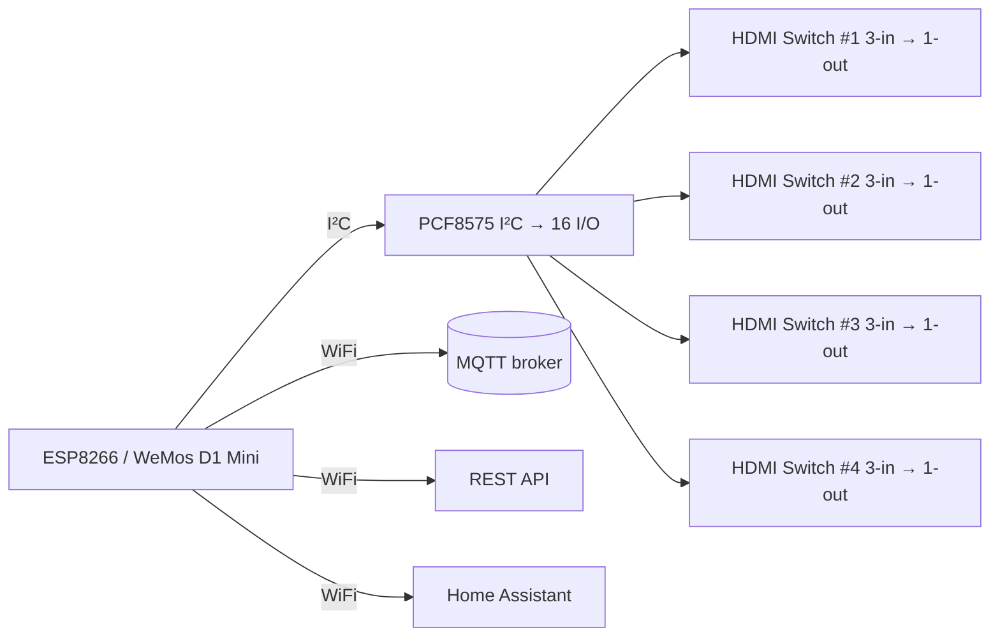

# Homemade 4×HDMI KVM Controller

This project is a DIY KVM‑like controller that manages **four HDMI 3‑in/1‑out switch boards** using a **WeMos D1 Mini (ESP8266)** and a **PCF8575 I²C I/O expander**. The ESP8266 provides remote control and monitoring of HDMI input selection through MQTT/HTTP, making it possible to integrate with smart home systems like Home Assistant.

---

## ✨ Features

* Control **4× HDMI 3‑in/1‑out switches** over Wi‑Fi.
* Simulate button presses to switch HDMI inputs.
* Monitor switch LED states to confirm active inputs.
* Expose MQTT topics and optional HTTP API for integration.
* Debug and control locally via **Serial commands**.
* Compact and low‑cost design using off‑the‑shelf modules.

---

## 🛠 Hardware

* **WeMos D1 Mini (ESP8266, Micro‑USB)** – main controller.
* **PCF8575 I²C → 16 I/O module** – extends GPIOs for buttons/LEDs.
* **4× HDMI Switch Boards** – 3‑in/1‑out, 4K/1080p capable.
* **NPN transistors (2N3904 or similar)** + **10 kΩ base resistors** – safe button simulation.
* **Resistor dividers** – scale LED voltages to 3.3 V logic.
* **Pull‑ups (4.7–10 kΩ)** – I²C lines.
* **Perfboard + wiring harnesses** – connections.
* **USB power distribution (5 V)** – shared across all modules.

---

## 🔌 Connections

* ESP8266 ↔ PCF8575: I²C bus (SDA/SCL + pull‑ups).
* PCF8575 → HDMI Switches:

  * Outputs → transistor circuits → button pads.
  * Inputs ← resistor dividers ← LED signals.
* Shared ground across all modules.

---

## 📡 Interfaces

### MQTT Topics

* **Commands:**

  * `kvm/cmd/route` → `{ "output": 1, "input": 2 }`
  * `kvm/cmd/press/{id}` → `{ "ms": 120 }`
* **State:**

  * `kvm/state/output/{id}` → `{ "input": 2, "leds": [0,1,0], "ts": ... }`

### HTTP API (optional)

* `GET /api/state` → JSON of all outputs.
* `POST /api/route` → body: `{ "output": 1, "input": 2 }`.
* `POST /api/press/{id}` → body: `{ "ms": 120 }`.

---

## ⌨️ Serial Command Reference

When connected via USB to the ESP8266 (baud **115200**), you can issue commands directly:

| Command | Action                                                  |
| ------- | ------------------------------------------------------- |
| `1`     | Pulse **P3** high → low (simulate button press #1).     |
| `2`     | Pulse **P7** high → low (simulate button press #2).     |
| `3`     | Pulse **P11** high → low (simulate button press #3).    |
| `4`     | Pulse **P15** high → low (simulate button press #4).    |
| `9`     | Read and print all PCF8575 input pin values (P15 → P0). |

**Example Output (Command `9`):**

```
1 - 0 - 1 - 0 - 1 - 0 - 0 - 1 - 1 - 0 - 0 - 1 - 1 - 0 - 0 - 1
```

Each number corresponds to the state of pins P15 down to P0.

---

## 📐 System Diagram (GitHub‑friendly)



This format is directly compatible with GitHub’s **Mermaid diagram rendering**.

---

## 🚀 Getting Started

1. Assemble hardware on perfboard (ESP8266, PCF8575, wiring to switches).
2. Flash ESP8266 with Arduino/PlatformIO firmware.
3. Configure Wi‑Fi and MQTT credentials.
4. Verify I²C communication (PCF8575 address, SDA/SCL pull‑ups).
5. Map PCF8575 pins to button/LED lines in firmware.
6. Test button press simulation and LED reads on one board.
7. Scale up to all 4 HDMI switches.
8. Integrate with Home Assistant (MQTT discovery).

---

## 📋 To‑Do / Next Steps

* Add per‑input direct select (instead of cycling button).
* Add local OLED display for quick status view.
* Optional isolation with optocouplers for noisy HDMI boards.
* Improve enclosure / cable management.

---

## 📄 License

Open‑source under MIT License. Feel free to adapt and improve!

---

## 🩺 Stability and Crash Diagnostics

### Observed problem

After weeks of uptime the board enters a reset loop. Serial output on `/dev/ttyUSB1` (115200 baud) showed WiFi and MQTT connecting, then `Exception (0)` (illegal instruction) with `epc1=0x40223dc1`. Decoding with `xtensa-lx106-elf-addr2line` against the build ELF gave:

* `udp_input` (lwIP `udp.c`) called from `ip4_input`, `ethernet_input`, `ppPeocessRxPktHdr` (WiFi RX path).
* `mem_malloc` (lwIP `mem.c`) also on the stack.

The crash is in the network stack while handling an incoming packet, which points to heap exhaustion or corruption that builds up over time, not to application logic.

### Changes made

* **Non-blocking MQTT reconnect**: no more `delay(5000)` loops. Reconnect is retried every 5 s from `loop()` and only when WiFi is connected, so the WiFi stack keeps being serviced.
* **Health monitoring**: every 60 s the firmware prints and publishes free heap, largest free block, fragmentation, RSSI and uptime to `home/office/hdmi-kvm/health`. A steadily falling heap indicates a leak.
* **Reset reason**: `ESP.getResetInfo()` is printed at boot.
* **Self-recovery**: restarts cleanly if free heap < 6000 B or largest free block < 3000 B.
* **Scheduled restart**: restarts after 7 days of uptime as a stopgap against slow leaks.
* **Build**: `platform = espressif8266@^4.2.1` (newer Arduino core and lwIP fixes), `-D PIO_FRAMEWORK_ARDUINO_LWIP2_HIGHER_BANDWIDTH`, debug build type and `esp8266_exception_decoder` monitor filter so crashes are decoded live in `pio device monitor`.

### Reading a crash

1. Run `pio device monitor -p /dev/ttyUSB1` (the exception decoder filter is enabled).
2. Or paste the stack dump into the Arduino ESP Exception Decoder, or run:
   `~/.platformio/packages/toolchain-xtensa/bin/xtensa-lx106-elf-addr2line -pfiC -e .pio/build/d1_mini_pro/firmware.elf <addresses>`
   The ELF must come from the same source that is flashed.

### Further ideas if resets persist

* Watch the `health` topic for a heap trend over days.
* Check for a weak or brown-out 5 V supply (resets with `rst cause:4` or `1`).
* Check for WiFi AP instability or reconnect storms (RSSI in the health payload).
